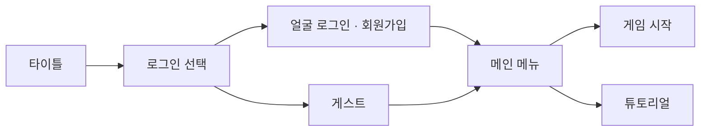
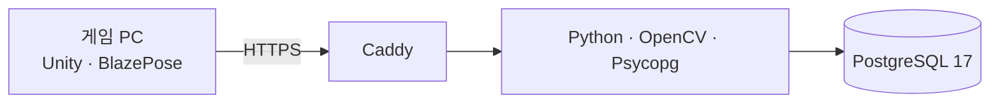

<div align="center">


### 몽스케이프 · 몸으로 뛰는 탈출 러너

광산 · 수레 갈림길 · 감옥 · 동물원을 **키보드** 또는 **웹캠 몸동작**으로 달리는 Windows 운동 러너

<br>


<br>


<sub>이전 이름: 무한옥</sub>

</div>

---

> [!NOTE]
> **2026-10-29** — PR #20과 기존 개선을 통합한 소스입니다. develop 병합만 진행하며 새 릴리스·태그·서버 배포는 하지 않습니다. 기존 공개 ZIP은 통합 이전 버전입니다.

## 🚀 바로 실행

```text
StartGame.cmd
```



- 계정 서버 없이도 **게스트 · 키보드 플레이**가 가능합니다.
- 몸동작 인식은 각 PC의 Unity 안에서 처리합니다.

## 🎮 조작법

| 동작 | 키보드 | 🧍 전신 (어깨~발) | 🙋 상체 (허리 위) |
| :--- | :---: | :--- | :--- |
| 좌우 이동 | <kbd>A</kbd> / <kbd>D</kbd> | 몸을 옆 구역으로 이동 | 상체를 옆 구역으로 이동 |
| 갈림길 가운데 | <kbd>C</kbd> | 사이드스텝으로 선택 | 사이드스텝으로 선택 |
| 점프 | <kbd>Space</kbd> | 실제 점프 | 두 손을 머리 위로 |
| 숙이기 | <kbd>S</kbd> | 상체 낮추기 | 상체 숙이기 |
| 하이니 | <kbd>W</kbd> | 한쪽 무릎 높이 들기 | 팔 번갈아 크게 흔들기 |
| 설정 · 성능 표시 | <kbd>F1</kbd> · <kbd>F3</kbd> | — | — |

> 메뉴는 손목 커서를 **0.75초** 머물러 선택할 수 있습니다.

## ✨ 주요 기능

<table>
<tr>
<td width="50%" valign="top">

#### 🏆 계정 · 랭킹
- 회원 계정의 **코인 · 상점 해금 · 운동 기록**
- 여러 PC를 묶은 **통합 랭킹**
- 게스트 기록은 이 PC에만 저장 (코인·아이템 없음)

</td>
<td width="50%" valign="top">

#### 🔥 운동 점수
- **점수 = 거리 + 65kg 기준 칼로리 × 100**
- 표시 칼로리는 입력 몸무게 기준 (생략 시 65kg)
- 키보드 플레이는 칼로리 0

</td>
</tr>
<tr>
<td valign="top">

#### 🧭 플레이
- 씨드 기반 장애물 · 레일 랜덤 배치
- 실제로 끌어당기는 **코인 자석**
- **코인 2배**, 바나나까지 막는 **방패**

</td>
<td valign="top">

#### 🎓 튜토리얼 · 인식
- 단계형 튜토리얼
- 점프 준비 · 숙이기 오인식 수정
- 보정 유지, 우측 하단 웹캠 표시 설정

</td>
</tr>
<tr>
<td colspan="2" valign="top">

#### 🎪 연출
목표/소모 칼로리 HUD · 경찰 사이렌 · 갈림길 표지 · 이어진 기린 목과 코끼리 코 · 쓰러지는 나무 · 자동 화질 조절

</td>
</tr>
</table>

## 🔐 얼굴 서버



- 얼굴 **사진은 저장하지 않고** 인식 특징값만 보관합니다.
- 기존 DB의 스키마 이전과 사진 삭제는 자동으로 실행하지 않습니다.

## 🛠️ 개발

1. Unity Hub에서 `PrisonRunner/Unity`를 **6000.3.10f1**로 엽니다.
2. 메뉴 **Mongscape → Play GameScene**을 실행합니다.
3. C# / URP, Unity AI Inference(BlazePose)를 사용하며 패키지는 업그레이드하지 않았습니다.

## 📚 문서

| 목적 | 문서 |
| :--- | :--- |
| 실행과 서버 주소 | [처음 읽기](PrisonRunner/START_HERE.md) |
| 통합 범위 · 검사 · 남은 일 | [진행 상태](PrisonRunner/docs/PROGRESS.md) |
| PR 원래 기능 계획 | [기능 계획](PrisonRunner/docs/FEATURE_PLAN_2026_10_28.md) |
| 계정 · 몸동작 · 저장 구조 | [아키텍처](PrisonRunner/docs/ARCHITECTURE.md) |
| 전체 안내 | [문서 목록](PrisonRunner/docs/README.md) |
| 외부 리소스 조건 | [출처](PrisonRunner/THIRD_PARTY_NOTICES.md) |

<details>
<summary><b>📦 백업 · 캡처 · 개인 데이터 안내</b></summary>
<br>

- 이전 문서와 캡처는 로컬 통합 백업으로 옮겼습니다.
- 새 검수 캡처는 Git에서 제외한 `Builds/QA`에 보관합니다.
- 개인 DB · 얼굴 · 토큰 · 설치별 서버 설정은 백업 정리나 공개 파일 대상으로 취급하지 않습니다.

</details>

<div align="center">
<br>
<sub>⛏️ 몸을 움직여 탈출하세요 ⛏️</sub>
</div>
